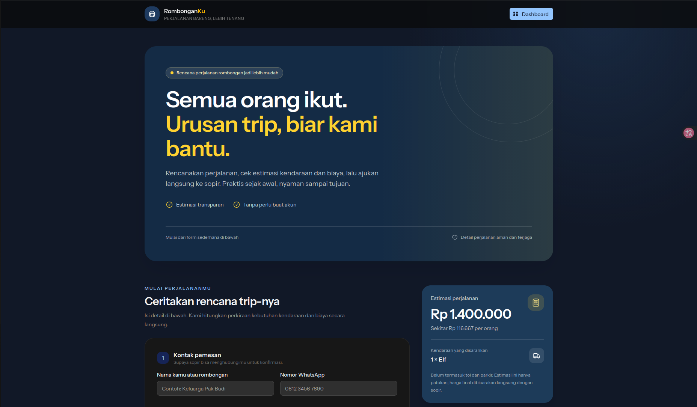
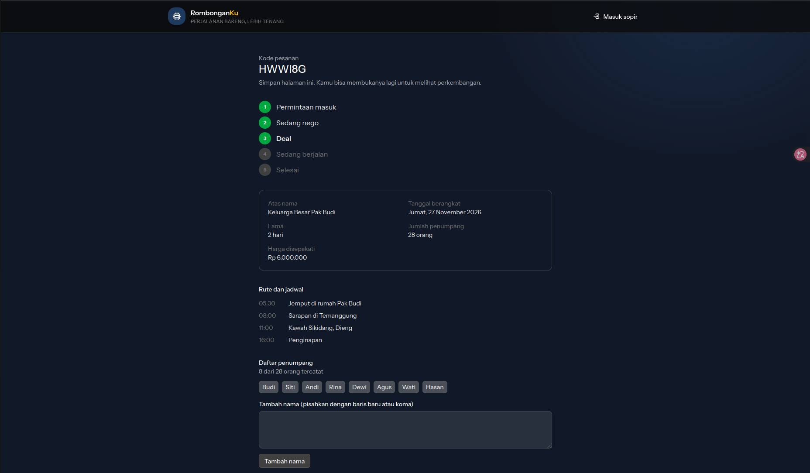
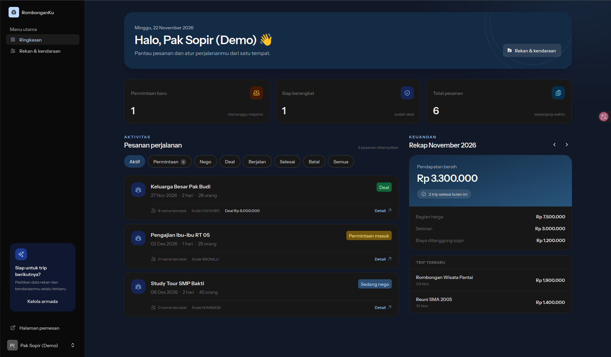
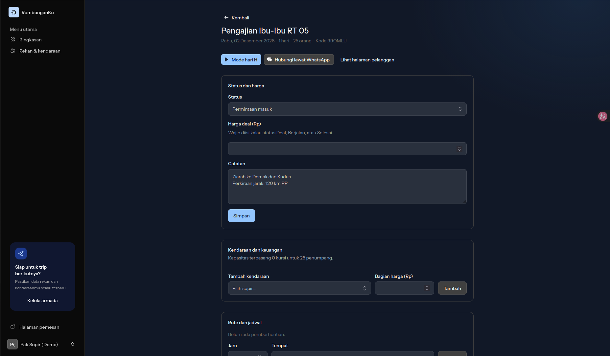

# RombonganKu

Aplikasi web untuk sopir yang membawa rombongan: dari permintaan masuk, nego harga, pembagian kendaraan, sampai absen penumpang di hari keberangkatan dan rekap pendapatan bulanan.

Ide ini datang dari bapak saya, seorang sopir di sebuah armada. Pesanan rombongan biasanya masuk lewat telepon, harganya hasil nego, dan kadang satu rombongan butuh beberapa kendaraan dari teman satu armada. Semua itu dulu dicatat manual. RombonganKu dibuat untuk merapikan alur itu.



## Masalah yang diselesaikan

| Masalah di lapangan | Solusi di aplikasi |
| --- | --- |
| Pelanggan telepon, detail trip sering terlewat | Form pengajuan trip dengan estimasi biaya langsung terlihat |
| Harga hasil nego, bukan tarif kaku | Estimasi hanya patokan. Harga deal diisi sopir setelah nego |
| Satu rombongan butuh beberapa kendaraan | Satu pesanan bisa memuat banyak kendaraan, masing-masing dengan sopir dan bagian harganya |
| Tidak tahu untung bersih tiap trip | Pendapatan bersih dihitung per trip, plus rekap bulanan |
| Penumpang ada yang ketinggalan | Mode hari H dengan checklist naik per kendaraan, dioptimalkan untuk HP |

## Fitur

**Untuk pelanggan (tanpa akun)**
- Kalkulator estimasi biaya yang berubah seketika saat jumlah penumpang, hari, dan jarak diubah. Kendaraan dipilih otomatis, dan kalau penumpang melebihi satu bus, dihitung beberapa kendaraan.
- Mengajukan trip lewat form, lalu mendapat kode dan link pelacakan (`/trip/KODE`).
- Memantau status pesanan, melihat rute, dan mengisi daftar penumpang sendiri.



**Untuk sopir (login)**
- Dashboard permintaan masuk dengan filter status: Permintaan, Nego, Deal, Berjalan, Selesai, Batal.
- Detail pesanan: harga deal, rute dan jadwal, tombol langsung ke WhatsApp pelanggan.
- Data tetap rekan satu armada dan kendaraannya.
- Keuangan per kendaraan: bagian harga, setoran, dan biaya (BBM, tol, parkir, makan) dengan pilihan siapa yang menanggung.
- Rekap bulanan pendapatan bersih.
- Mode hari H: checklist penumpang naik per kendaraan, checklist pemberhentian, tombol mulai dan selesaikan trip.





## Keputusan desain

**Estimasi bukan harga final.** Di lapangan harga selalu dinego, jadi sistem hanya memberi patokan. Harga yang berlaku adalah angka yang diisi sopir setelah deal.

**Pelanggan tanpa akun, tapi tetap punya halaman sendiri.** Pelanggan rombongan jarang mau mendaftar untuk sekali jalan. Sebagai gantinya, tiap pesanan punya kode acak 6 karakter yang unik dan link pelacakan. Halaman itu tidak pernah menampilkan setoran, biaya, atau pendapatan sopir.

**Aturan pendapatan bersih.**

```
pendapatan bersih = bagian harga - setoran - biaya yang ditanggung sopir
```

Biaya yang ditanggung pelanggan tidak mengurangi pendapatan. Setoran dan biaya hanya dicatat untuk kendaraan bertanda "Saya". Untuk kendaraan rekan, aplikasi hanya mencatat bagian harganya. Aturan ini punya test otomatis.

**Satu pesanan, banyak kendaraan.** Harga deal berlaku untuk seluruh rombongan, sedangkan tiap kendaraan punya bagian harga sendiri. Aplikasi memberi peringatan kalau total bagian tidak sama dengan harga deal, atau kalau kursi kurang dari jumlah penumpang.

**Pembatasan akses berlapis.** Data difilter per sopir, kepemilikan dicek ulang di setiap aksi Livewire (bukan hanya saat halaman dibuka), dan nilai yang tidak boleh diubah dari browser dikunci. Pesanan milik orang lain mengembalikan 404.

**Uang disimpan sebagai bilangan bulat rupiah**, tanpa desimal, supaya tidak ada masalah pembulatan.

## Teknologi

- Laravel 13, PHP 8.3
- Livewire 4 (komponen satu file) dan Flux UI
- Tailwind CSS, Vite
- SQLite untuk pengembangan, kompatibel dengan MySQL
- Pest/PHPUnit untuk test

## Menjalankan di lokal

Kebutuhan: PHP 8.3 atau lebih baru, Composer, Node.js dan npm.

```bash
git clone git@github.com:stellartechara/rombonganku.git
cd rombonganku

composer install
cp .env.example .env
php artisan key:generate

touch database/database.sqlite
php artisan migrate --seed

npm install
composer run dev
```

Buka `http://localhost:8000`.

Akun demo (dibuat oleh seeder):

- Email: `demo@rombonganku.test`
- Password: `password`

Seeder juga mengisi contoh pesanan di berbagai status, dua rekan, dan dua trip selesai supaya rekap bulanan langsung terlihat.

## Test

```bash
php artisan test
```

Test mencakup rumus pendapatan bersih (termasuk biaya yang ditanggung pelanggan dan setoran kosong), kode pelacakan yang unik, dan rekap bulanan (hanya trip selesai, hanya kendaraan sendiri, batas awal dan akhir bulan, serta isolasi antar sopir).

## Batasan saat ini

- Tarif di kalkulator adalah angka contoh di `app/Support/TripEstimator.php`, bukan harga resmi.
- Permintaan dari landing page masuk ke akun sopir pertama. Pemilihan sopir untuk versi multi-sopir belum ada.
- Belum ada notifikasi otomatis. Sopir menghubungi pelanggan lewat WhatsApp secara manual.
- Cegah bentrok jadwal antar kendaraan belum diimplementasikan.

## Rencana berikutnya

- Cegah bentrok jadwal per sopir dan kendaraan
- Peran admin untuk pemilik armada
- Tampilan peta rute
- Ekspor itinerary ke PDF